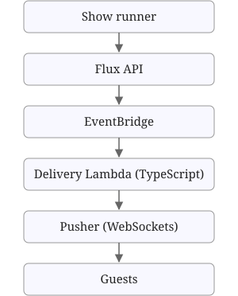

For the last five years (and some change) I've been working for Little Cinema
Digital (LCD) building [a platform called Flux](https://builtwithflux.com/) to
support the interactive live events for which LCD is known. The Flux platform
has two "sides", one for authors and one for guests. Guests don't have any
reason to know about Flux; it's just another website. Authors use Flux to build
a site's content and define its behavior. Authors can also define behavior to
occur on the site in response to custom instructions from the platform to be
triggered during a live event; you may recall I said _interactive_ live events.
An instruction could reveal a poll when the host poses a
question, or change the background color as the headliner takes the stage. Show
runners are the lucky friends who decide when to trigger the defined
instructions during the live event to cause the scripted behavior for guests.

Reducing the latency between when a show runner triggers the instruction and
when the guest receives the instruction reduces stress for the show runner and
makes the events feel more interactive because it means behaviors are more
likely to land on cue. If a show runner has to account for latency then
interactive moments are more likely to happen a beat early (because the show
runner tried to account for latency and missed) or a beat late (because they
didn't and there was too much latency). Most events don't have many of these
defined instructions to be triggered but when there are defined instructions,
it is in Flux's interest to get them delivered as fast as possible. 1000ms (or
one second) was considered an acceptable end-to-end latency though our target
was an end-to-end latency at or below 500ms.

<figure class="diagram">

<figcaption>The original instruction delivery pipeline.</figcaption>
</figure>

The initial implementation for this instruction delivery pipeline was, like the
rest of the project, written in TypeScript. With the instruction delivery
pipeline in TypeScript the end-to-end latency showed a p90 of about 2000ms;
this is not what anyone would call "real-time" and it doubled what we
considered acceptable. In measuring the sources of the end-to-end latency the
data clearly showed a network hop from the Flux API to EventBridge to the
delivery Lambda (600ms) and the Lambda cold start time (700ms) were consuming a
surprisingly large portion of our performance budget. The remaining time went
to delivery Lambda execution, getting data into Pusher and from Pusher to
guests. All on its own the Lambda cold start in TypeScript overran our target
for end-to-end latency. Flux has to plan around cold starts for a few reasons:

- The side of the platform servicing live events is idle 90% of the time; sites
  still get traffic when idle but in small volumes and there are no interactive
  moments when the event isn't live. This means we realize important cost
  savings by using infrastructure that can scale to zero. "Keep it warm"
  strategies would undermine part of our design philosophy.
- Not many of these instructions go out, even during a live event. Over the
  course of an event with a two-hour duration more than half of the time the
  Lambda execution environment responsible for delivering instructions will have
  spun down, resulting in the next invocation hitting a cold start.
- The Flux platform is designed to be "hands off" for operators. LCD doesn't
  want to require the engineering team to be on call to spin up reserved
  capacity for an event and then have to remember to spin it back down after
  the event.

Easy choice first: we dropped the EventBridge network hop and now invoke the
Lambda directly. It is still a network hop---a cheaper, more predictable one.

Even after that, in order to deliver the instructions anywhere close to our
target we had to get up off our comfy TypeScript couch and consider
alternatives. Looking at [cold start benchmarks
published](https://maxday.github.io/lambda-perf/) by
[maxday](https://maxday.dev) it was obvious the best chance to hit our target
was to write the delivery Lambda in Rust (thanks
[cargo-lambda](https://www.cargo-lambda.info/)). A lot of the work of
delivering the instructions is I/O and so using Rust doesn't have much impact
there but using Rust sure does trim the cold start time. The Rust version of
the Lambda gives us cold start times of roughly 100ms.

Breaking from Flux's standard practice of "TypeScript everywhere" is its own
tradeoff. Most of the team isn't comfortable with Rust and now message shapes
need to be defined in multiple places and in multiple languages and those
shapes need to be kept in sync. Converting a fairly simple Lambda function from
TypeScript to Rust in order to turn an impossible end-to-end latency
target---cold start time alone exceeded it---into an achievable one made this
tradeoff feel justified.

In the end we don't reliably hit the 500ms target mostly due to the remaining
network hop from our API to the Rust Lambda and a worldwide audience for many
events. There are certainly additional gains to be found but our p90 end-to-end
latency for these instructions is around 750ms, which is comfortably below what
was considered acceptable, so we didn't pursue them. When latency mattered,
letting the JS runtime's cold start eat the whole latency budget before doing
any work just didn't make sense.
